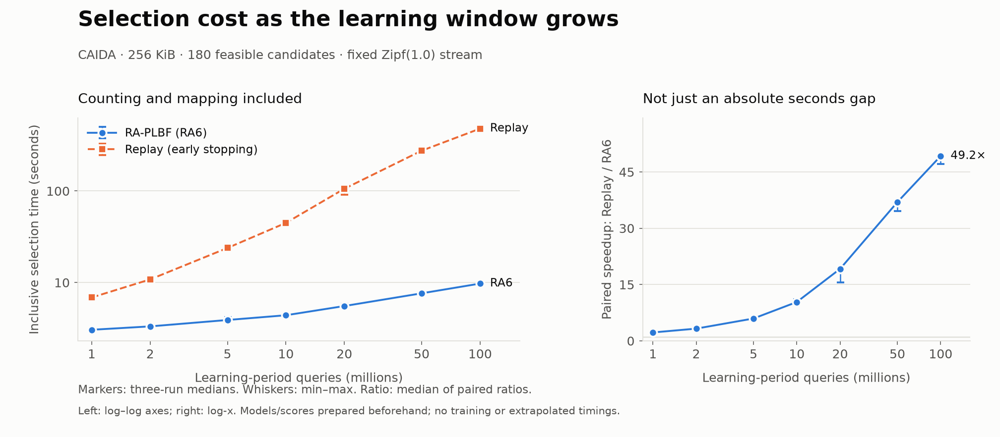

# RA-Gama: repetition-aware memory allocation for learned Bloom filters

**English** | [简体中文](README.zh.md)

This repository contains the code, frozen experiment protocols, logs and results for **RA-PLBF**, whose main method is **RA6**. It extends the model/filter allocation problem studied by Gama (CIKM 2025) with a cache of verified false-positive keys and learning-window repetition statistics.

**Start here:** [latest eight-setting timing report, in English](windows_research/round14_main_e2e_v2/results/report.md) · [full BF+cache baseline coverage](windows_research/round13_complete/results/baseline_report.md) · [reproduction details](REPRODUCING.md)

The entry point and latest timing report are in English; many historical research notes remain in Chinese. This is a **public, non-anonymized research repository**, not a claim of an accepted or artifact-evaluated paper.

## What RA6 does

1. Use the first 25% of a query stream to estimate repetition and predict false positives over the remaining 75%.
2. Search model-tree prefixes and negative-cache memory fractions, with a FastPLBF dynamic-programming allocator for score segments.
3. Build the five leading candidates from the frozen first-stage ranking, then rerank using their actual false-positive bucket loads.

The cache is 4-way set-associative CLOCK. Evaluation starts with an **empty cache**. The no-repeat reduction is to the **shared-engine Gama configuration**, not to an ordinary Bloom filter, and does not imply that RA6 always beats other baselines.

The shared-engine experiments charge packed Bloom-filter storage, executable model arrays, allocated cache bytes and array headers. **The authors' original Gama implementation uses a different accounting scheme** and is reported separately.

## Quick verification: no datasets, third-party checkout or LaTeX required

Clone normally and use Python 3.10+ with only its standard library:

```bash
git clone https://github.com/123kaze/ra-gama.git
cd ra-gama

# Check complete BF/BF+cache coverage, budgets, stream digests and summary arithmetic.
python3 windows_research/round13_complete/src/verify_baselines.py

# Reconstruct and compare the latest eight-setting timing tables from all 72 records.
python3 windows_research/round14_main_e2e_v2/src/report14.py --verify-only
python3 windows_research/round14_main_e2e_v2/src/test_report14.py -v

# Check the earlier URL/COD paired prefix-scoring experiment.
python3 windows_research/round13_complete/src/verify_scoring.py
```

These commands verify **archived results**, not freshly trained models or new timing measurements. The round-14 checker explicitly reports original-source files unavailable in a non-recursive clone; it does not claim to have checked or executed missing upstream code. On the experiment host, `--inputs` additionally requires all frozen source files and hashes the original datasets, CSVs and query fixtures.

For historical round-10/11 tables:

```bash
python3 scripts/reproduce_results.py --table all --output reproduced
```

Those historical TCP-only BF comparisons use the older conservative-header baseline. The stronger physical-accounting baseline is in **rounds 12–13**; do not substitute the old table for the new one.

## A genuine from-scratch smoke test

With the main environment installed, this command generates a fixed synthetic dataset, trains a model, selects/builds filters and executes native queries without downloading research datasets:

```bash
.condaenv/bin/python windows_research/round12_nomodel/src/minimal_e2e.py --output reproduced/e2e.json
```

This is a correctness and executability check, **not performance evidence**. It does not require RA6 to win; its ordinary BF+cache result is retained even when better.

## Latest results and their limits

### Complete ordinary BF+cache controls

Round 13 completes coverage of the original **1,146 cases**, **16 TCP-only settings**, and **4 MAWI-24 settings**, in both verified-prefix and fp64 cache formats: **2,332 aligned cache-specific comparisons**.

- Excluding probe replay leaves 1,076 original-main cases. The pre-existing reference-FP threshold of at least 30 retains 748 cases. Against BF+cache, both formats have **718 wins, 0 ties and 30 losses**.
- All 30 retained losses are fresh-key adversarial workloads: 10 CAIDA and 20 Shalla cases. Low-count results and the 70 probe-replay cases are disclosed separately.
- On **TCP-only**, both formats lose in **13/16 settings**. Median `(FP_RA6+1)/(FP_BFcache+1)` is **1.063** for the indexed format and **1.053** for fp64. This concerns the tested features, membership construction and budgets, not all learned filters on TCP.
- The added MAWI-24 baselines and fp64 runs are **post-hoc supplements**, not a new independent holdout.

Cases share models, datasets and query pools; hundreds of rows are **not hundreds of independent statistical samples**. Probe-replay methods replay their own false positives, so their evaluation tails are not elementwise identical across structures.

### Optimized full construction: the eight main-table settings

Round 14 reruns **original G-PLBF, RA6-loop and RA6-leaf in the same campaign**: eight settings, three repetitions and 72 fresh single-threaded processes, run serially with rotated method order. A separate three-process pilot is excluded.

All **24 RA6 pairs** match in model/14-prefix score digests, selected configuration, filter payloads and native query counts. All three methods reproduce their corresponding round-7 configurations/counts.

| Dataset | Budget (KiB) | Loop/leaf construction speedup | Leaf/original construction cost ratio |
|---|---:|---:|---:|
| CAIDA-flow | 24 | 2.313× | 10.375 |
| URL | 128 | 2.034× | 4.996 |
| MAWI-20 | 24 | 2.095× | 18.514 |
| MAWI-21 | 24 | 1.824× | 14.227 |
| MAWI-22 | 24 | 2.033× | 16.763 |
| CAIDA synthetic | 256 | 2.625× | 3.782 |
| Shalla | 1024 | 2.500× | 0.964 |
| COD | 1024 | 1.712× | 0.828 |

Each ratio is the **median of three paired ratios**, not a ratio of separate medians. A cost ratio below one favors RA6-leaf.

- Relative to RA6-loop, construction improves in all 24 pairs; the eight setting-level speedup medians span **1.71–2.62×**.
- Relative to original G-PLBF, optimized construction still loses in **6/8 settings**. Shalla's slightly favorable median is not uniform: one of its three repetitions is slower. No significance claim is made.
- Construction plus the full negative tail is faster in **7/8 settings**; CAIDA synthetic remains **1.774×** the original's total computation time.
- Whole-process peak-RSS paired medians increase by **2.9–21.7%** relative to the loop implementation across these settings. Chunked leaf IDs avoid a full-dataset leaf matrix, but do not imply lower total memory.
- The query implementation is unchanged. The newly measured query times are **not evidence that prefix-score preparation accelerates service queries**.

`train_to_ready_s` includes training, scoring/preparation, selection and executable-filter construction. It excludes data reading, JIT warm-up, verification, query-input assembly and evaluation queries. `process_wall_s` includes additional work and is not construction time. Construction-plus-tail excludes database, network and backing-store lookup latency.

The earlier round-13 paper-source URL/COD experiment reports **2.36–2.57×** for a different set of 20 combinations and did not remeasure original Gama. Do not substitute its speedups for the eight-setting results above.

### Selection scaling: 1M–100M learning queries



[English report and phase breakdown](windows_research/round15_learning_scaling_v2/results/report.md) · [PDF](windows_research/round15_learning_scaling_v2/figures/learning_scaling.pdf) · [Linear-axis view](windows_research/round15_learning_scaling_v2/figures/learning_scaling_linear.png)

Round 15 fixes CAIDA, 256 KiB, Zipf 1.0 and 180 feasible candidates, using nested learning prefixes and three fresh single-threaded repetitions per method and length (42 workers).

- From 1M to 100M learning queries, RA6's selection median grows **3.049 → 9.747 seconds**, versus **6.867 → 479.965 seconds** for early-stopping Replay.
- Median paired speedup rises at every measured length: **2.24× → 49.24×**. Both timers include all learning-dependent preprocessing; training and common scores/segment inputs are prepared beforehand.
- Even with early stopping, Replay processes about **64–66L candidate query events**; its ordered replay phase reaches a 455.33-second median at 100M. RA6 reuses per-key statistics instead of replaying the ordered trace for each candidate.
- This supports an **amortized trace-analysis / selection-scalability argument**, not a proof of different asymptotic classes in L at fixed candidate count. The frozen counter is sort-based, population work depends on distinct keys, and this is one finite pool/workload—not new held-out effectiveness evidence.

```bash
# Standard-library verification of the complete archived figure data:
python3 windows_research/round15_learning_scaling_v2/src/report15.py --verify-only
python3 windows_research/round15_learning_scaling_v2/src/test_report15.py -v
```

### Zero-tree candidate extension: partial weak-model improvement

[RA6-Z English report](windows_research/round17_zerotree/results/report.md) · [中文结论](windows_research/round17_zerotree/results/结论.md) · [Failure-stage diagnosis](windows_research/round17_zerotree/results/diagnostics.json)

Round 17 adds thirteen physically accounted ordinary BF/cache candidates to the global predictive shortlist. This is **RA6-Z**, a new post-hoc method—not a rewrite of frozen RA6. Selected zero-tree filters deploy without model or feature arrays. All 192 cases / 1,536 method records pass native correctness, budget checks and five original-reference regressions.

| TCP-only cache | Zero-tree selected | Old RA6 / BF+cache FP ratio | RA6-Z / BF+cache FP ratio | New win/tie/loss |
|---|---:|---:|---:|---:|
| Indexed | 8/16 | 1.0629 | 1.0084 | 6/2/8 |
| fp64 | 9/16 | 1.0526 | 1.0149 | 6/2/8 |

Ratios are medians of per-case `(FP_method+1)/(FP_reference+1)`. Losses fall from 13/16 to 8/16 per format, **not to zero**. One setting per format regresses relative to original RA6 (284→285 FP indexed; 378→411 FP fp64). All 80 stronger-model controls remain configuration/FP-identical to RA6; all 80 fresh-adversarial controls also remain unchanged, including the original failures.

Remaining TCP losses occur when zero-tree is pruned before construction (5 indexed / 4 fp64), built but loses refinement (2/2), or selected with a different cache fraction from replay (1/2). Candidate availability does not guarantee a no-regret future-tail fallback. Search still evaluates learned candidates; this is not zero training cost.

```bash
python3 windows_research/round17_zerotree/src/report17.py --verify-only
python3 windows_research/round17_zerotree/src/test_report17.py -v
```

### Frequency-gap repair: completed in round 19

[Repaired entry point and usage](windows_research/round19_gt_fix/README.md) · [Verified old/new report](windows_research/round19_gt_fix/results/report.md) · [中文结论](windows_research/round19_gt_fix/results/结论.md) · [Original read-only audit](windows_research/round18_gt_audit/results/report.md)

The post-freeze local repair retains empirical count c only for `gt=True`, `2<=c<=5` and empty `N[c+1]`. Singleton, counts above 5 and `gt=False` remain unchanged. **Frozen round4 code is preserved:** use the new `summarize19` / scoped `entry19.patched()` entry point; old experiment drivers do not silently become repaired implementations.

- All 1,146 main-case statistics were rechecked: **1,132 byte-identical**, 14 affected. The four MAWI-24 budgets and 51 supplementary learning inputs are unchanged.
- All 14 affected cases were rechecked in both cache formats, with indexed top3/5/10, warm, RA4 ablations and candidate prediction/ranking checks. Each format has **five changed RA6 FP counts**, including regressions; not all results are unchanged.
- Against BF+cache, **718/748 wins and 30 losses remain unchanged**, as do the median ratios. Exact same-format Replay aggregates change slightly: indexed median 0.9994613441→0.9994815262; fp64 0.9955383568→0.9956155076. See full-precision records, not a claim of statistical equivalence.
- This fixes repeated-count collapse, not boundary discontinuity, nonmonotonicity or non-unit total mass. Original timing/significance results keep their old-version attribution; neither was remeasured/retested here. The original holdout record remains intact.

```bash
# Standard library: reproduce and verify the repaired archive
python3 windows_research/round19_gt_fix/src/report19.py --verify-only
# Existing main environment: repair invariants and runtime-hook tests
.condaenv/bin/python windows_research/round19_gt_fix/src/test_summarize19.py -v
```

### Explicit zero-tree guard: no BF+cache losses in the tested matrix

[Round20 report](windows_research/round20_zero_guard/results/report.md) · [中文结论](windows_research/round20_zero_guard/results/结论.md)

**RA6-ZGate** retains the repaired RA6 winner and the exact learning-replay winner of 13 BF/cache candidates. It chooses the smaller actual learning FP (ties prefer no model), instead of letting predictive top-five pruning eliminate the BF family. All 192 learning-window minimum checks pass.

On the unchanged round17 matrix, its evaluation-tail comparison against BF+cache is **80 wins / 112 ties / 0 losses**: all 32 TCP-only and 80 fresh-adversarial cases choose zero trees, while all 80 stronger-model controls keep RA6. This is a measured finite-matrix result, **not a future-query guarantee**. Against RA6, the result is **86 wins / 80 ties / 26 losses**; all regressions are retained.

The added BF-family and learned-anchor learning replays are real costs. This variant does not inherit the old 49.24× statistics-only speedup or the unconditional no-repeat reduction to Gama (the new guard can select BF instead). It also does not avoid training during search or prove database latency gains.

```bash
python3 windows_research/round20_zero_guard/src/report20.py --verify-only
python3 windows_research/round20_zero_guard/src/test_report20.py -v
```

### KL / shrinkage / zero-tree: limited actual-data diagnostic

[English report](windows_research/round22_kl_diagnostic_v2/results/report.md) · [中文结论](windows_research/round22_kl_diagnostic_v2/results/结论.md) · [Conditional A/B scatter](windows_research/round22_kl_diagnostic_v2/figures/kl_diagnostic.png)

The exploratory **KL-EB22-static13** compares four static learned prefixes (cache=0) with 13 BF/cache candidates; it is **not full cache-aware EB-RA6** and has no confidence-bound non-regression guarantee. All13 prespecified non-holdout cases completed: versus BF+learning replay,9 wins /2 ties /2 losses. All four TCP-only settings select zero trees, but CAIDA/Shalla fresh-adversarial cases still select worse learned filters.

Across47 same-tree/static comparisons, EB shrinkage improves24 and worsens23 FP counts. Only35 of141 actual static candidates satisfy the unclipped A identity's conditions; B's two-interior-solution condition holds for27. The scatter distinguishes measured static-filter FP from a **conditional continuous-model** AM/GM check—B is not an empirical q/r-filter deployment result.

The theoretical counterexamples and initial serialization failure are preserved separately. No retuning follows the outcomes; no paper change or universal KL-gate benefit is asserted. The cancelled shared-replay campaign remains stopped and is not presented as a completed result.

```bash
python3 windows_research/round22_kl_diagnostic_v2/src/report22.py --verify-only
python3 windows_research/round22_kl_diagnostic_v2/src/test_report22.py -v
```

One unused report script in the broad experiment-host freeze differs from the user's rewritten publication prose. This exact, reporting-only variant is explicitly documented in the round22 README and archive verifier; no runtime/math/selector hash is exempted and no deleted content is restored.

### Lightweight models and training-objective experiments (rounds 23–26)

[Research notes / 思考.md](docs/README.md) · [Lightweight-model plan](docs/轻量模型与缓存感知Bloom过滤器_研究思路.md)

These files are now mirrored from the experiment repository, rather than available only on its `bloom/submission-baselines` branch. Original notes/results are retained; this is not a replacement of frozen RA6 or the paper's main experiments.

| Round | Experiment | Outcome and scope |
|---|---|---|
| [23](windows_research/round23_lightweight/results/report.md) | Six lightweight scorers plus pure BF; 36 trainings, 84 static-filter records | URL shows memory/FP/inference tradeoffs; all tested TCP learned models still lose to plain BF. Some URL optimizers hit their iteration cap. |
| [24](windows_research/round24_cell_router/results/report.md) | Two-feature, 3-bit-per-cell region table; 24 builds | Fast routing but limited discrimination; complete router costs 696/1240 bytes including edges/headers, not just table payload. |
| [25](windows_research/round25_filter_training/results/report.md) | Same MLP8 capacity, BCE continuation versus capped filter-aware loss; 48 records | All three URL128KiB initializations reduce FP; URL64KiB is mixed and TCP remains worse than BF. No cache or quantization in this test. |
| [26](windows_research/round26_weighted_tree/results/report.md) | Same LightGBM settings, Uniform / TrafficGT / EscapeGT weights | 96 feasible + 12 infeasible configurations. EscapeGT versus Uniform: 17 wins / 2 ties / 13 losses across 32 matched configurations; no stable few-tree replacement for 160 trees demonstrated. |

The **cancelled shared-replay work is preserved only as an incomplete archive**: [round21](windows_research/round21_shared_replay/README.md) and [round21 v2](windows_research/round21_shared_replay_v2/README.md). V2 recorded 735/2880 timings before cancellation; the wrong-thread startup batch is separately excluded. It must not be treated as a completed speedup experiment or restarted implicitly.

```bash
# Standard-library checks of completed archives; no new training/query campaign:
python3 windows_research/round23_lightweight/src/report23.py --verify-only
python3 windows_research/round25_filter_training/src/report25.py --verify-only
python3 windows_research/round26_weighted_tree/src/report26.py --verify-only
```

Native timings here amortize Python calls over compiled loops; they are not database or scalar Python API latency. Weight generation in round26 uses a fixed-reference, score-bin transfer to disjoint training negatives—not true future per-key escape counts. All unfavorable outcomes and stopping conditions remain recorded.

### Real HTTP traffic, mechanism tests and actual SQL feedback (rounds 27–31)

[Execution checklist / 计划表](docs/实验与审查修复计划_20261121.md) · [Read-only archive verifier](docs/verify_rounds27_31.py)

| Round | Completed evidence | Outcome and boundary |
| --- | --- | --- |
| [27](windows_research/round27_http_real/README.md) | NASA real HTTP missing-resource requests; 90 method records | Non-protocol features have AUC about0.862–0.901. RA improves over Replay at4/8KiB but still loses to BF+Cache. Retrospective stable-catalog construction, not a live mutable-site benchmark. |
| [28](windows_research/round28_reweight_mechanism/README.md) | 168 paired settings,504 physical BF builds; theoretical-gain/actual-gain scatter | Continuous interior identity verified; clipping, physical-BF noise and coupled CLOCK shown separately. TCP correlation is stronger than URL; losses retained. Synthetic popularity on real features, not a new trace. |
| [29v2](windows_research/round29_evidence_audit_v2/README.md) | Eight-dataset cluster bootstrap;60 resource rows; collision injection | Indexed RA/Replay effect0.975084,95%interval[0.947281,1.001171]. No general FP superiority/equivalence claim. Failed [v1](windows_research/round29_evidence_audit/STATUS.md) preserved. |
| [30](windows_research/round30_submission_audit/README.md) | Source/numeric audit and18 no-repeat tests | SQLite old timing is label-driven batch simulation plus SQL;13/16 sensitivity,800MB trace versus931MB learning state,GT mass4/3 verified. No selection counterexample found in the bounded18-setting search. |
| [31](windows_research/round31_sqlite_online/README.md) | Eight settings, two SQLite backends, three repeats:312 timings | Each accepted query immediately executes SQL; only a returnedNone admits a negative. All masks and final cache bytes match reference,0memberFN. RA is faster in6/16settings than NoFilter,12/16than Gama,0/16than BF+Cache. Python scalar orchestration overhead is included. |

```bash
# Standard library only; reads archives, never reruns experiments or edits the manuscript.
python3 docs/verify_rounds27_31.py
```

Historical results remain distinct from these post-hoc additions. The original `pvldb-submission` tag is not moved; the cancelled round21 is not restarted and previously deleted material is not restored. The round29 publication check accepts only the already documented exact report17 prose-hash variant; runtime/algorithm hashes are not exempted. Manuscript suggestions are archived as Markdown/a review patch, not represented as a fully updated or newly compiled paper.

### Explicit no-repeat dispatch, normalization and backend-cost sensitivity (rounds 32–34)

| Round | Verified scope | Result and limitation |
| --- | --- | --- |
| [32](windows_research/round32_no_repeat_guard/README.md) | RA6-NR32 explicitly uses the frozen Gama path on no-repeat input;140regression cases and4repeated controls | All140deployment payloads match byte for byte; repeated controls stay unchanged. This is a new post-freeze variant, not a proof of universal equivalence for unmodified RA6. |
| [33v2](windows_research/round33_gt_normalization_v2/README.md) | GT19 plus seen-mass and total-mass normalization;180records | No stable FP improvement. Seen normalization win/tie/loss:3/22/5 indexed,2/23/5 fp64; total normalization:4/24/2 and1/25/4. The [stopped v1](windows_research/round33_gt_normalization/STATUS.md) retains129records; v2adds only component timing and preserves all overlapping non-timing outputs. |
| [34](windows_research/round34_backend_cost/README.md) | Fixed filters/200Krequests; six artificial per-SQL cost levels;288timings | At+50us RA is faster than BF+Cache in5/8settings; at+100us in6/8, with those wins consistent across all3paired repetitions. All query masks/FPcounts/cache states match round31. This is local SQLite plus artificial CPU waiting, **not real remote-database performance**. |

```bash
# Read-only, standard-library archive verification:
python3 docs/verify_rounds32_34.py
```

[Backend-cost curves](windows_research/round34_backend_cost/results/figures/cost_ratios_light.png) retain prior and contemporary-zero-cost predictions separately. The old6/8and7/8forecasts are not substituted for observed5/8and6/8wins. Near-ties, scalar Python overhead, precomputed-feature scope and setup-cost exclusions remain explicit. No original main algorithm or MAWI-24holdout is silently replaced.

### Important methodological boundaries

- RA6's approximately 3% overall advantage over learned-space Replay is **not significant at the 0.05 level in the archived cluster-aware analysis**. Similar effectiveness with cheaper selection is distinct from a universal false-positive improvement.
- The verified-prefix cache needs a sorted member-hash index, **8 bytes/member outside the filter budget**. The fp64 cache does not consult that index during cache operations, but fingerprint collisions can cause false negatives. Finite member checks are not a universal zero-false-negative guarantee; some older experimental loaders still allocate the index.
- Original Gama uses pickle-based model accounting and its own Bloom-filter backend. Nominally equal budgets do not imply equal physical storage. Language, representation and query-engine differences remain even in the new contemporaneous timings.
- The four original real-trace tasks use UDP members and TCP negatives. The separate TCP-only experiment is necessary and cannot be replaced by favorable results on the original construction.
- Round 8 uses public original data sources associated with the Gama paper, **not an exact reconstruction of the authors' unpublished splits**. The unavailable Yelp dataset is not claimed as reproduced.

## Repository map

| Path | Purpose |
|---|---|
| `windows_research/round5_dp/` | Shared FastPLBF DP engine and the main experimental plan |
| `windows_research/round6_bucket/` | Frozen RA6, original main table, holdout and supplementary studies |
| `windows_research/round7_original_e2e/` | Original implementation versus RA6: initial eight-setting end-to-end campaign |
| `windows_research/round8_paper_data/` | Public-source URL/COD comparisons with original G-LBF/G-PLBF |
| `windows_research/round9_eq7/` | Offline finite-window equation correction and prediction-bias diagnostics |
| `windows_research/round10_fpcache/` | fp64 cache and same-format learned-space replay controls |
| `windows_research/round11_tcp/` | TCP-only membership/query construction |
| `windows_research/round12_nomodel/` | Strong no-model controls, exact overhead accounting, cost/deployment audits, from-scratch smoke test |
| `windows_research/round13_complete/` | Complete BF+cache coverage and initial chunked-prefix-scoring validation |
| `windows_research/round14_main_e2e_v2/` | Latest 72-process eight-setting campaign and English timing report |
| `windows_research/round14_main_e2e/` | Preserved first-launch preflight failure; no training process started |
| `windows_research/round15_learning_scaling_v2/` | Inclusive selection scaling from 1M to 100M queries; 42 workers, figures and scan-count evidence |
| `windows_research/round15_learning_scaling/` | Preserved instrumentation-import failure before selection measurements |
| `windows_research/round17_zerotree/` | RA6-Z zero-tree extension; 192 cases, model-free deployment, partial TCP improvement and remaining failures |
| `windows_research/round18_gt_audit/` | Historical read-only diagnosis of the frequency gap; repair and rechecks are in round19 |
| `windows_research/round19_gt_fix/` | Local repeated-frequency-gap repair; input invariance, 28 cache-specific rechecks, revised RA-family/candidate results |
| `windows_research/round20_zero_guard/` | Explicit t=0 learning-replay guard; 192 cases, no tail loss to BF+cache here, all 26 regressions versus RA6 disclosed |
| `windows_research/round21_theory_check/` | Independent conditional KL/AM-GM proofs and numerical counterexamples; not the cancelled replay experiment |
| `windows_research/round22_kl_diagnostic_v2/` | 13-case static KL/EB/t=0 diagnostic, full candidate records and conditional-model scatter |
| `windows_research/round22_kl_diagnostic/` | Preserved serialization-failed smoke; no completed performance result |
| `windows_research/round21_shared_replay/`, `round21_shared_replay_v2/` | Cancelled/superseded shared-replay implementations and incomplete records; not final performance evidence |
| `windows_research/round23_lightweight/` | Lightweight scorer screen, exact physical budget and native timing |
| `windows_research/round24_cell_router/` | Static two-feature cell-to-region table prototype |
| `windows_research/round25_filter_training/` | Matched-capacity MLP training-loss comparison |
| `windows_research/round26_weighted_tree/` | LightGBM negative-weight-only experiment with query-mass control |
| `docs/` | Research directions and user-provided coupling-optimization notes |
| `original_baselines/` | Original baseline drivers, pinned submodules and patches |
| `learned_adaptive_hybrid/`, `legacy/` | Earlier studies, retained as historical records |
| `environment/`, `data/README.md` | Pinned environments and dataset preparation locations |

Protocols and source hashes are frozen per round. Later work imports or copies earlier code rather than silently editing a measured version. Logs retain local paths and hardware information as provenance.

## Full experiments and environments

The pinned environments target **macOS arm64 / Apple M4 Pro**. Other platforms must resolve compatible packages; identical timings are not expected.

```bash
conda create -p .condaenv --file environment/main.osx-arm64.lock.txt
conda create -p .condaenv_gama --file environment/gama.osx-arm64.lock.txt
.condaenv_gama/bin/python -m pip install -r environment/gama.pip.txt

# Fetch pinned upstream repositories and regenerate local patched files.
scripts/setup_third_party.sh
# Optional: also build the external C/C++ baseline drivers.
# scripts/setup_third_party.sh --no-fetch --build
```

Prepare datasets and round-7 query fixtures using the linked data and round-specific instructions before running the latest campaign. Large datasets are not bundled. The main environment uses conda-forge LightGBM; the authors' original implementation uses its separate Python 3.10 environment.

The full launcher is `windows_research/round14_main_e2e_v2/src/run14.py`. **It is resume-oriented**: completed checked outputs are skipped, and failed/incomplete existing outputs are rejected. An ordinary clone already contains completed outputs; invoking the launcher there is not a fresh rerun. Use a separate experiment copy/output location and preserve the archived results before arranging a new timing campaign. Do not run memory-heavy timing workers concurrently.

## License

The original code, protocols and results in this repository are released under the [MIT License](LICENSE). Third-party code keeps its own license, as described below.

## Third-party code and archival status

See [THIRD_PARTY.md](THIRD_PARTY.md). Unlicensed upstream implementations are referenced through pinned submodules and local patches, **not copied into this repository**. Generated adapter files are ignored by Git. BSD-licensed adaptive-filter ports retain their upstream license files. Fetching a submodule does not grant a new license or permission to redistribute it.

No Zenodo DOI is asserted here. A durable archival release needs an authenticated account, confirmed creator metadata and appropriate licensing; this README does not invent any of these.
